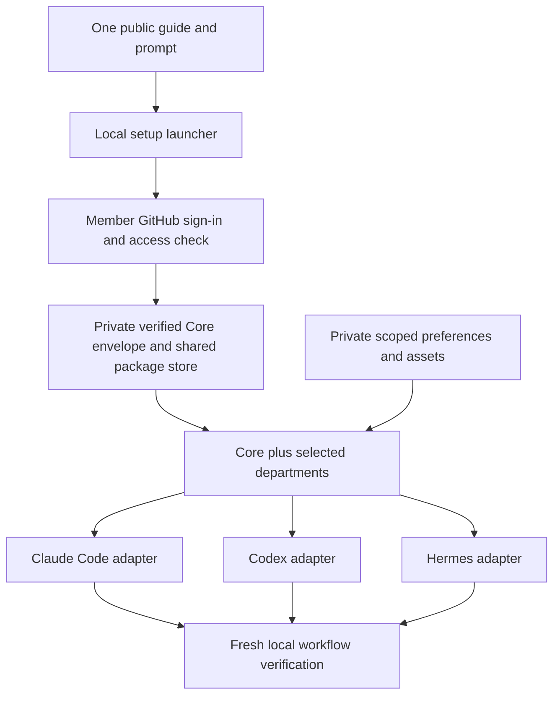

# What member setup installs

Start with [the canonical guide and prompt](getting-started.md). This map helps
the setup agent select requested capabilities without installing every repository.
It is an onboarding audit of repository purpose, manifests and entry documents,
not an end-to-end certification of every skill or third-party integration.

## Portable release

| Module | Source repository | Included skills | Installation |
|---|---|---:|---|
| Core | [genie-aios](https://github.com/Claude-Code-Academy/genie-aios) | 4 | Included by default |
| Content OS | [genie-plugin-marketplace](https://github.com/Claude-Code-Academy/genie-plugin-marketplace) | 36 | Optional `content-os` |
| Mobile OS | [genie-mobile-os](https://github.com/Claude-Code-Academy/genie-mobile-os) | 17 | Optional `mobile-os` |
| Web OS | [genie-web-os](https://github.com/Claude-Code-Academy/genie-web-os) | 12 | Optional `web-os` |

These counts describe the **v0.1.0-alpha.1** package manifests, not guaranteed
ready workflows. Claude Code, Codex and Hermes adapters use the same package
store. Claude/Codex use skill links, Hermes uses external skill directories;
owned instruction bridges and necessary native supplements remain adapter-specific.
Windows can use directory links or a complete-bundle compatibility fallback.
Private preferences and assets live separately and survive department updates.

## Other repositories: install only for a requested need

| Repository | Current role | Member setup treatment |
|---|---|---|
| [genie-ecosystem](https://github.com/Claude-Code-Academy/genie-ecosystem) | Public launcher, guide and map | The single starting point; no private package source is published here |
| [genie-plugin-marketplace](https://github.com/Claude-Code-Academy/genie-plugin-marketplace) | Nine first-party native Claude plugins | Content OS has the portable package above. Essentials, coaching, Google Workspace, iOS pipeline, second brain, skill authoring, Skool and analytics remain separate native offerings. Do not register duplicates of portable departments |
| [genie-skills-library](https://github.com/Claude-Code-Academy/genie-skills-library) | Standalone skills, including library-only capabilities | Optional native/legacy route; not all are portable modules. Inspect the requested skill and preserve private customizations |
| [genie-curated-marketplace](https://github.com/Claude-Code-Academy/genie-curated-marketplace) | Eleven curated catalog entries, including remote MCP services | Optional third-party native integrations. Respect upstream licensing, declared host support and individual authentication; not part of portable Core |
| [genie-cowork-plugin-marketplace](https://github.com/Claude-Code-Academy/genie-cowork-plugin-marketplace) | Separate Cowork catalog; currently zero bundles | No installable department here yet. Do not present it as Claude Code or portable desktop support |
| [genie-second-brain](https://github.com/Claude-Code-Academy/genie-second-brain) | Obsidian/Git sync kit and course reference | Optional separate setup. Not the marketplace's `second-brain` skill plugin; sync schedules/accounts require their own setup and authorization |
| [genie-directory](https://github.com/Claude-Code-Academy/genie-directory) | Reference index of skills/plugins | Discovery aid only; its summary counts are stale. Check source manifests before making an install decision |
| [genie-whitelabel](https://github.com/Claude-Code-Academy/genie-whitelabel) | Template catalog; currently no listed projects | No template to install from this catalog yet |
| [expo-revenuecat-claude-starter](https://github.com/Claude-Code-Academy/expo-revenuecat-claude-starter) | Public app starter | Optional generated-project starting point; not a Genie runtime prerequisite |
| [genie-public-assets](https://github.com/Claude-Code-Academy/genie-public-assets) | Public default images | Referenced assets; no local installation required |
| [.github](https://github.com/Claude-Code-Academy/.github) | Organization profile and contribution templates | No member installation |

The two private maintainer repositories (`genie-internal-skills` and
`genie-internal-plugins`) are not member dependencies. Do not request access or
install them as part of community setup. This accounts for all **16 repositories**
visible in the organization inventory on **2026-10-10**.

## Audit findings and limits

- The four portable product repositories retain ownership of their source. The
  public guide consumes a released, checksum-pinned envelope rather than current
  product branches. Source changes alone do not update an installed portable bundle.
- Older README, command and agent entry instructions defaulted to Claude's
  `init.py`/plugin-cache export route. The public guide and the four portable
  product entry points now route new setup through the portable installer;
  explicitly selected legacy workflows remain documented separately.
- The skill library and older native marketplace documentation contain their own
  installation instructions. They are optional references, not alternative
  automatic onboarding defaults. Do not follow old shell-profile token-export
  advice; use native authentication and the [access guidance](member-access.md).
- The published installer can provision missing prerequisites and clients through
  declared routes, but real native sign-in, desktop prompts, skill discovery and
  service access still require local verification. Documentation does not turn
  alpha provisioning into certification. Optional unsupported capabilities remain
  blocked rather than silently omitted.
- No live member installation, account removal, paid service action, deployment or
  publishing workflow was performed for this documentation audit. Existing private
  checkouts, generated projects, personal preferences and credentials were preserved.

Evidence baseline: Core `a311b95`, marketplace `730dc74`, Mobile `6c9f48d`,
Web `9d4e280`, public launcher `98866b1`; release tag `v0.1.0-alpha.1`.
Recheck live default branches, package manifests, release assets and official
vendor documentation when updating this map. The [bootstrap reference](portable-bootstrap-preview.md)
contains the current source-level provisioning details; the
[release notes](releases/portable-v0.1.0-alpha.1.md) retain qualification limits.
